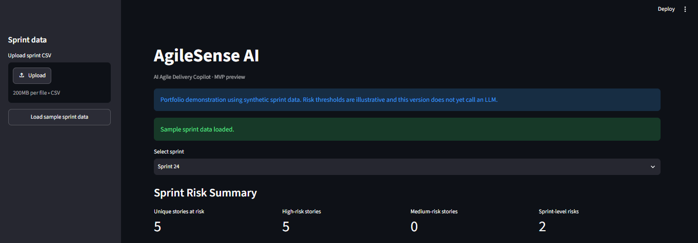
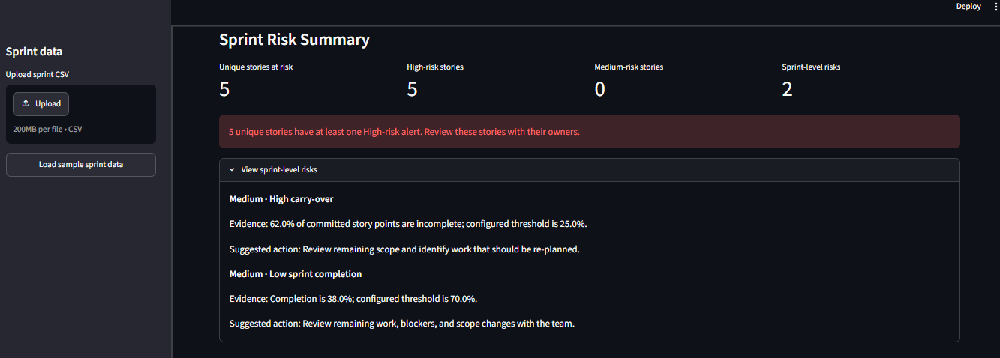
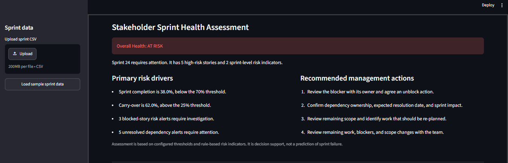
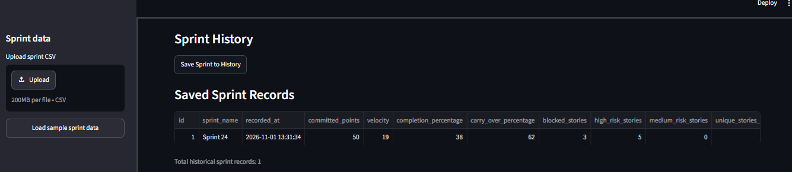
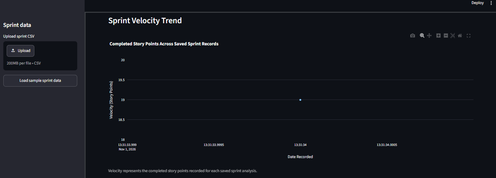

AgileSense AI

AI-Powered Agile Delivery Intelligence Platform

An AI-enabled delivery copilot for Scrum Masters and Product Owners

AgileSense AI helps Agile delivery teams understand sprint health, identify delivery risks, monitor historical performance and communicate actionable insights to stakeholders.

It combines deterministic sprint analytics and explainable risk assessment with an LLM-powered AI Copilot that translates delivery findings into clear explanations and practical recommendations.

1. Business Problem

Scrum Masters and Product Owners often rely on spreadsheets, manual tracking and multiple reporting tools to understand sprint performance.

This can make it difficult to:

Identify delivery risks early.

Understand the impact of blockers and dependencies.

Track sprint completion and carry-over trends.

Communicate sprint health consistently.

Convert delivery metrics into actionable stakeholder recommendations.

AgileSense AI addresses this problem through a unified Agile delivery intelligence dashboard.

2. Product Vision

To help Agile delivery teams make informed, timely and transparent decisions through explainable analytics and AI-assisted recommendations.

Target Users

Scrum Masters

Product Owners

Agile Delivery Managers

Engineering Managers

Project and Program Managers

3. Key Features

Sprint Analytics

Upload sprint data through CSV files.

Validate uploaded sprint data.

Calculate committed story points and completed story points (velocity).

Calculate sprint completion percentage.

Track carry-over percentage and blocked stories.

Visualise story status distribution.

Explainable Delivery Risk Engine

Identifies delivery risks using configurable business rules, including:

Blocked stories.

Unresolved dependencies.

High carry-over percentage.

Low sprint completion percentage.

Provides evidence-based risk findings and severity levels.

Stakeholder Sprint Health Assessment

Classifies sprint health as:

ON TRACK

NEEDS ATTENTION

AT RISK

Highlights primary risk drivers and recommended management actions.

AI Sprint Copilot

Uses the OpenAI API to:

Explain sprint health in natural language.

Summarise key delivery concerns.

Recommend Scrum Master actions.

Generate stakeholder-friendly sprint communication.

Historical Sprint Analytics

Save sprint analysis records in SQLite.

Review historical sprint performance.

Visualise sprint velocity trends.

Stakeholder Reporting

Generate downloadable PDF reports containing:

Sprint health assessment.

Delivery metrics.

Risk summaries.

Risk drivers.

Recommended actions.

4. Product Screenshots

### AgileSense AI Dashboard

### Delivery Risk Assessment

### Stakeholder Sprint Health

### Sprint History

### Sprint Velocity Trend

### AI Sprint Copilot
![AI Sprint Copilot](docs/screenshots/ai-copilot.png

5. Product and AI Design Principles

AgileSense AI follows a human-in-the-loop approach.

Deterministic analytics and AI have separate responsibilities:

Component

Responsibility

Python analytics engine

Calculate sprint metrics

Rule-based risk engine

Identify delivery risks

Stakeholder assessment

Determine sprint health using configured rules

LLM-powered Copilot

Explain findings and generate recommendations

Scrum Master / Product Owner

Review findings and make decisions

The AI does not independently calculate sprint metrics or override the rule-based health assessment.

This separation improves explainability and helps reduce the risk of unsupported AI-generated conclusions.

6. Technology Stack

Area

Technology

Programming language

Python

User interface

Streamlit

Data processing

Pandas

Visualisation

Plotly

AI integration

OpenAI API

Database

SQLite

PDF reporting

ReportLab

Testing

Pytest

Development environment

VS Code

Version control

Git and GitHub

7. System Architecture

flowchart TD
    A[CSV Sprint Data] --> B[CSV Validation]
    B --> C[Sprint Analytics Engine]
    C --> D[Rule-Based Risk Engine]
    D --> E[Stakeholder Health Assessment]
    C --> F[Historical Sprint Database]
    E --> G[AI Sprint Copilot]
    D --> G
    C --> G
    E --> H[PDF Stakeholder Report]
    G --> I[AI Explanation and Recommendations]
    C --> J[Streamlit Dashboard]
    D --> J
    E --> J
    F --> J
    I --> J

8. Project Structure

agilesense-ai/
│
├── data/
│   ├── sample_sprint_data.csv
│   └── agilesense_history.db
│
├── docs/
│   └── system-architecture.md
│
├── src/
│   ├── analytics/
│   ├── copilot/
│   ├── history/
│   ├── ingestion/
│   ├── reporting/
│   ├── risk/
│   └── app.py
│
├── tests/
│   ├── test_csv_validator.py
│   ├── test_sprint_metrics.py
│   └── test_risk_engine.py
│
├── .env
├── .gitignore
├── requirements.txt
└── README.md

9. Getting Started

Prerequisites

Python 3.13

Git

OpenAI API key

Clone the Repository

git clone <YOUR_GITHUB_REPOSITORY_URL>
cd agilesense-ai

Create a Virtual Environment

python -m venv .venv

Activate it on Windows PowerShell:

.\.venv\Scripts\Activate.ps1

Install Dependencies

python -m pip install -r requirements.txt

Configure the OpenAI API Key

Create a .env file in the project root:

OPENAI_API_KEY=your_api_key_here

Never commit .env or expose your API key in GitHub.

Run the Application

streamlit run src/app.py

Open the local Streamlit URL displayed in your terminal.

Run Tests

python -m pytest -q

10. Sample Sprint Scenario

The sample Sprint 24 dataset demonstrates how AgileSense AI analyses delivery performance.

Metric

Sample Result

Committed story points

50

Completed story points

19

Sprint completion

38%

Carry-over

62%

Blocked stories

3

High-risk stories

5

Sprint-level risk indicators

2

Overall health

AT RISK

These figures illustrate the sample dataset and are not industry benchmarks.

11. Current Product Status

MVP implemented:

CSV ingestion and validation.

Sprint analytics.

Rule-based delivery risk assessment.

Stakeholder sprint health assessment.

AI-powered sprint health explanation.

PDF stakeholder reporting.

SQLite sprint history.

Sprint velocity trend visualisation.

Potential future enhancements:

Conversational Q&A over sprint data.

Story-level AI recommendations with evidence references.

Multi-sprint delivery insights.

Jira integration.

Role-based access.

Cloud deployment.

More advanced predictive analytics, subject to data availability and validation.

12. Responsible AI Approach

AgileSense AI uses AI as a decision-support capability, not as an autonomous decision-maker.

Its design principles include:

Preserve deterministic calculations for metrics.

Use explainable rules for risk identification.

Provide relevant sprint context to the LLM.

Distinguish reported facts from AI recommendations.

Keep delivery decisions with human stakeholders.

13. Product Perspective

AgileSense AI was conceived as a practical solution to a real Agile delivery challenge.

The project demonstrates product discovery thinking, feature prioritisation, MVP development, AI integration, explainable decision support and stakeholder-focused product design.

The goal is not simply to add AI to an Agile dashboard. It is to make Agile delivery information easier to understand and act upon.